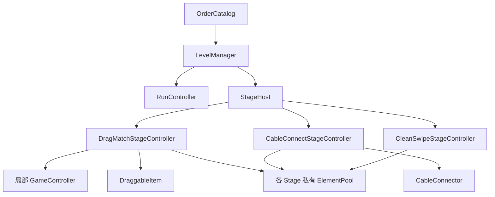

# DeskRescue / 桌面急救站 — Day 4 架构 / V0.0.4

更新日期：2026-10-08。项目使用 Cocos Creator 3.8.8、TypeScript、720 × 1280 设计分辨率。

Day 4 将固定三物品流程升级为 **9 张订单、13 个步骤、3 种微玩法**。正式入口仍为 `Game.scene` 上的 `LevelManager`，内容读取 `OrderCatalog`。本文件描述代码及自动测试；Creator 实际装配、保存、审计、引擎 probe、Preview 与设备验证的最终事实以 [DAY4_CREATOR_VALIDATION.md](DAY4_CREATOR_VALIDATION.md) 为准。

## 1. 代码职责与依赖

| 文件 | 职责 |
| --- | --- |
| `assets/scripts/data/StageDefinition.ts` | `StageKind`、三种具体配置与 `StageDefinition` discriminated union |
| `assets/scripts/data/OrderDefinition.ts` | 订单身份、章节、评分规则、非空步骤序列 |
| `assets/scripts/data/OrderCatalog.ts` | 9 张静态订单、递归冻结、纯目录校验 |
| `assets/scripts/core/LevelManager.ts` | 订单和步骤编排、HUD、教学、结算、重玩 |
| `assets/scripts/core/RunController.ts` | 订单级时间、失误、评分及只读结果 |
| `assets/scripts/stages/StageHost.ts` | 按 union 分支选择实际组件、缓存三个 Stage 实例、过滤过期回调 |
| `assets/scripts/stages/StageRuntime.ts` | `StageProgress`、`StageCallbacks`、公共生命周期契约 |
| `assets/scripts/stages/ElementPool.ts` | 单个 Stage 私有的可增长节点池 |
| `assets/scripts/stages/DragMatchStageController.ts` | 动态 Item/Target 配置、局部 `GameController` 回调转接 |
| `assets/scripts/stages/CableConnectStageController.ts` | Cable/Port 配置、连接数、线缆玩法完成门槛 |
| `assets/scripts/gameplay/CableConnector.ts` | 线头输入、坐标转换、Graphics 连线、吸附和回位 |
| `assets/scripts/stages/CleanSwipeStageController.ts` | 污渍网格、线段扫掠、清洁阈值和淡出 |
| `assets/scripts/gameplay/DraggableItem.ts` | 继续复用既有拖拽判定和动画 |
| `assets/scripts/core/LegacyLevelManager.ts` | 保留 Day 3 编排实现，供历史回归 fixture 使用 |

Stage 通过回调报告进度、失误和完成，不导入 `LevelManager`。`GameController` 不导入上层编排器。正式 StageHost 使用静态导入及 `getComponent(具体组件类型)`，没有 Resources/网络加载或字符串反射查找玩法组件。

## 2. 配置及校验

`StageDefinition` 由以下三个接口组成，`kind` 是判别字段：

| kind | 配置核心字段 | 完成条件 |
| --- | --- | --- |
| `drag-match` | `defaultSnapDistance`、非空只读 `pairs` | 全部指定物品归位 |
| `cable-connect` | 非空只读 `cables`，各自半径、文字、起点、接口、`CableStyle` | 全部线头接入指定接口 |
| `clean-swipe` | `brushRadius`、`requiredRatio`、非空只读 `areas` | 清洁数达到 `ceil(totalCells × requiredRatio)` |

`OrderDefinition` 包含 `id`、`key`、`chapterTitle`、`title`、`scoreRule` 和非空只读 `stages`。位置和尺寸都是只读数值对象；配置不存 Cocos `Color`。`CableStyle` 固定为 red、blue、yellow、green、purple、orange，由 `cableStyleColor()` 转换为颜色。

`ORDER_CATALOG` 在运行时递归 `Object.freeze`。`validateOrderCatalog(orders)` 是不改变调用者数据的纯校验函数，模块导入和 `loadOrder()` 都会调用它。校验失败明确抛 `RangeError`：

- 订单 id 为唯一正整数，key 唯一；stage id 在订单内唯一，元素 id 在 stage 内唯一；文字不能为空。
- 每张订单 1～3 个步骤，drag/cable 各 2～4 个元素。
- clean 总格数 1～64，每个 area 网格为正整数，尺寸和画笔半径为有限正数，比例在 0.5～1.0。
- 坐标在 StageHost 的 `x ∈ [-360,360]`、`y ∈ [-400,400]` 内；清洁 area 整个矩形也须位于范围内。
- 吸附半径为有限正数，颜色枚举合法，三星时间/失误阈值不能宽于二星。

目录校验不静默裁剪或修复数据。新增订单只需要增加 TypeScript 配置，现有八个 Prefab 和 `Game.scene` 无需逐订单修改。

## 3. 固定订单目录

评分列为“最大秒数 / 最大失误数”。达到对应星级必须同时满足两个条件，等于阈值也算满足。

| id | 章节 / 订单 | 按顺序执行的步骤 | 三星 | 二星 |
| --- | --- | --- | --- | --- |
| 1 | 基础订单 / 桌面整理 | drag：鼠标、键盘、耳机，3 对 | 20 / 0 | 40 / 2 |
| 2 | 基础订单 / 线缆急救 | drag：电源线、网线、USB 线，3 对 | 25 / 0 | 45 / 2 |
| 3 | 基础订单 / 维修订单 | drag：路由器、手柄、音箱，3 对 | 30 / 1 | 50 / 3 |
| 4 | 维护入门 / 键盘除尘 | clean：8 × 4，完成 28 / 32 格 | 25 / 0 | 50 / 1 |
| 5 | 维护入门 / 主机接线 | cable：电源线、显示线、网线，3 根 | 35 / 0 | 65 / 2 |
| 6 | 维护入门 / 鼠标保养 | clean：5 × 4，完成 17 / 20 格 → drag：电池、滚轮，2 对 | 55 / 1 | 95 / 3 |
| 7 | 综合维修 / 路由器布线 | cable：电源线、入户网线、电脑网线，3 根 | 40 / 0 | 75 / 2 |
| 8 | 综合维修 / 直播桌急救 | drag：麦克风、摄像头、补光灯、声卡，4 对 → cable：麦克风线、摄像头线，2 根 | 65 / 1 | 115 / 4 |
| 9 | 综合维修 / 电脑综合维修 | clean：7 × 5，完成 32 / 35 格 → cable：主板电源、CPU 电源、SATA 线、风扇线，4 根 → drag：风扇、内存、硬盘、显卡，4 对 | 100 / 2 | 170 / 6 |

前三张由 `migrate(LEVEL_CATALOG[index])` 复制 Day 3 数据，保持 id、顺序、标题、说明、物品/目标文字、位置、半径和评分规则；第二张仍是 drag 回归订单。默认半径分别为 96、64、64。

新增布局固定如下：

- 订单 4：区域中心 `(0,0)`，520 × 260，画笔 46，比例 0.85。
- 订单 5：起点 x=-260，y=[180,0,-180]；对应端口 x=260，y=[-180,180,0]；半径 72。
- 订单 6：清洁中心 `(0,20)`，300 × 260，画笔 44，比例 0.85；两个部件从 x=±160、y=-220 拖到同 x、y=150，半径 72。
- 订单 7：起点 x=-260，y=[180,0,-180]；对应端口 x=260，y=[0,-180,180]；半径 72。
- 订单 8：四列 x=[-240,-80,80,240]，起点 y=-230、目标 y=150，半径 78；两根线从 `(-220,120)`、`(-220,-120)` 接到 `(220,-120)`、`(220,120)`，半径 72。
- 订单 9：清洁中心 `(0,20)`，460 × 340，画笔 48，比例 0.90；四根线起点 x=-260、y=[240,80,-80,-240]，对应端口 x=260、y=[-80,240,-240,80]，半径 72；最后四列布局同订单 8。

## 4. StageHost 与池的生命周期

每种 Stage controller 的 `configure()` 接收自己的具体配置类型；公共 `StageRuntime` 提供 `progress`、`setInputEnabled()`、`resetStage()`、`deactivateStage()`、`resumeStage(callbacks)`。

`StageCallbacks` 只有三个函数：`onProgress({completed,total})`、`onMistake()`、`onComplete()`。各层独立使用 generation 和完成标记，切换/停用后旧输入及 tween 回调失效，完成只对当前步骤生效一次。

StageHost 的 `loadStage(definition, callbacks)` 按 `kind` 选择 Prefab；每种 Prefab 最多 `instantiate` 一次。切换时停用旧 Stage 并缓存，任意时刻最多一个 Stage root active。其公开接口还包括：

| API / 查询 | 行为 |
| --- | --- |
| `setInputEnabled(enabled)` | 仅当前未完成且有效 Stage 可响应输入 |
| `deactivateStage()` | generation 失效、清回调、停用当前 root |
| `resumeStage(callbacks)` | 为当前未完成 Stage 安装新回调，保留已完成进度 |
| `resetAll()` | 所有已缓存玩法恢复初始状态，缓存实例保留 |
| `releaseCache()` | 销毁缓存 root，Stage 随之释放自己的元素池 |
| `currentKind/currentStageId/currentGeneration/cachedStageCount` | 只读调试查询 |

`ElementPool.prepare()` 只在缺少节点时补足；4→2 时保留多余节点但 inactive，再次 4 时使用原节点。切换不 destroy 元素；Stage 的 `onDestroy()` 才释放池。池数组快照冻结，但其中 Node 是调试引用，不应由上层越过 controller 修改玩法状态。

各 Stage 另提供只读查询：drag 的 `itemNodes/targetNodes/pooledItemCount/pooledTargetCount`；cable 的 `cableNodes/portNodes/pooledCableCount/pooledPortCount`；clean 的 `cellNodes/pooledCellCount/totalCells/requiredCells/cleanedCells`。`progress` 返回冻结对象。

## 5. 三种输入规则

拖拽继续使用 `DraggableItem` 和 Stage 内局部 `GameController`。抓取偏移、多指 ownership、世界坐标转换、CANCEL 语义保持；拾取 0.10 秒、正确吸附 0.15 秒、错误回位 0.18 秒。正确吸附回调结束才增加进度，错误释放立即记一次失误。

`CableConnector` 持有 `head`、`line`、`anchor` 三个 Inspector 引用。它记录 owning touch id，把 UI 坐标转换到 head 父节点空间，并把指定 port 的世界坐标转换到同一空间；port、line、anchor 可以在不同父节点。Graphics 每次移动及 tween 更新时重画连线。错误接口和空白均记一次失误；重复 END、foreign touch 不重复计数；CANCEL 立即回起点且不记失误。结算动画期间锁输入，正确连接结束后锁定该线。`currentPort/isConnected/isAnimating` 为只读调试查询。

clean 将区域均匀分成 dirt cells，START 即清洁，MOVE 扫掠上一指针到当前指针的整条线段，避免快速滑动跳过中间格。命中格只计一次，0.08 秒淡出后 inactive；达到 `ceil(total × ratio)` 即锁输入并完成，进度分母使用 requiredCells。CANCEL 结束 ownership，保留已经清洁的格；空白与 CANCEL 不记失误。reset 恢复 opacity=255、active 和未清洁状态，旧 fade 回调不能隐藏新一轮格。

## 6. 订单编排、时间和结算

`LevelManager` 保留 `loadLevel(index)`、`nextLevel()`、`restartCurrentLevel()`、`playAgain()`，并提供 `loadOrder(index)`、`loadStage(index)`、`nextOrder()`。查询为 `currentOrderIndex/currentLevelIndex/currentStageIndex/totalOrders/totalStagesInCurrentOrder/state`。

一张订单只调用一次 `RunController.beginLevel()`。步骤完成后直接进入下一步，时间与失误保留；最后一步才 `finishLevel()`。无效索引不会跳关；完成状态、索引和 order/stage generation 一起过滤重复或旧回调。

计时仍由组件 `update(deltaTime)` 驱动，不读系统时钟。加载前 pause，Stage active 且输入启用后 resume；`skipNextFrame()` 保守跳过一次后续 `update`，避免将同步配置/实例化耗时算给玩家。它会同时略去该次更新中本可计入的少量游玩时间，属于保守近似，并非精确扣除 CPU 构造耗时。显式测试用 `advanceTime()` 不受跳帧标记影响；没有人为延迟或定时器。

得分仍为 `max(100, 1000 - floor(elapsedMs / 1000) × 10 - mistakes × 100)`。三星与二星分别同时判断时间和失误，边界包含。结果、结果数组及 summary 冻结；重复 finish 不会产生新结果。

HUD 包括章节、`订单 n / 9`、`步骤 n / m`、当前标题、说明与进度。`formatStageProgress()` 确定性输出 `已归位 n / total`、`已连接 n / total` 或 `清洁进度 floor(n/required×100)%`。前八张结算按钮显示“下一张订单”，第九张显示“重新挑战”。单订单结果五行，增加“步骤：m / m”；总结果六行，包含“完成订单：9 / 9”“总评价：… / 27 星”“完成步骤：13 / 13”。

重开当前订单回 stage 0、清当前时间/失误，并仅丢弃当前订单对应的末尾结果，保留之前的订单结果。重新挑战清空整轮结果、复位三个缓存 Stage，并回订单 1 / 步骤 1。快速重复按钮不会跳过新订单。

## 7. 教学与暂停

每个 `LevelManager` session 用 `Set<StageKind>` 记录已看教学：首次进入 kind 显示，第一次有效进度大于 0 后隐藏并记为已看；错误、CANCEL 和尚未结束的吸附不会隐藏。之后同 kind、重开和 playAgain 不重显；新 Scene session 可重显。没有持久化或全局单例。

停用 Manager 时移除按钮 listener、取消面板 tween、停用 Stage 并 pause。重新启用只有 Playing 状态恢复输入和时间，且安装新代回调；已结算状态保持冻结。destroy 清理并释放缓存。结果面板保留 0.8→1.08→1 的反馈动画，时长 0.14+0.10 秒。

## 8. 自动验证及证据边界

`npm test` 一次执行 `tools/verify-day1.cjs`：检查真实项目类型后编译实际 TS 组件，复用同一个 mock runtime 执行四天测试。

| 项目 | 实现时检查结果 | 边界 |
| --- | --- | --- |
| Day 1 / 2 / 3 | 11 + 19 + 28 = 58 组保留 | 历史编排 fixture 改用 `LegacyLevelManager`，原断言未删除/弱化；公共组件仍使用当前代码 |
| Day 4 | 新增 56 组，共 114 组通过 | 真实编译组件的 mock 行为测试；覆盖新的正式 LevelManager、Host 和三种 Stage |
| 类型负向契约 | 9 个预期 TS 错误 | 验证 union 错误分支、readonly 修改、空 tuple 被拒绝；不计行为组 |
| 质量审计 | 依赖方向、无类型绕过/网络加载/全局框架、严格选项 | 源码/配置检查单列，不计行为组 |
| 真实 SDK 项目检查 | `npm run check:cocos` 通过 | Creator 生成的真实配置及 SDK 引用；strict/unused 开启、skipLibCheck=false |
| SDK 自身声明 | 102 条语义诊断另列 | jsb.d.ts 18 条、cc.d.ts 84 条；未修改 SDK 隐藏错误 |

`tools/test/cc.d.ts` 只是有限测试契约，新增 Prefab、instantiate、Graphics、Sprite、UIOpacity 及必要 Node API；不冒充 Cocos SDK。Prefab mock 工厂只装配实际项目组件；Tween mock 检查终点、时长参数及回调归属，不模拟真实 easing、渲染或自然帧播放。

真实 Editor 执行的装配、资产审计和 probe 与 Preview 必须另有证据。合成 `cc.Touch/cc.EventTouch` 和手动推进真实 TweenSystem 不能代替浏览器触摸适配器、手机 WebView 或物理触屏验证，最终状态见 [Day 4 实测记录](DAY4_CREATOR_VALIDATION.md)。Day 3 文档和证据保留历史事实。本次范围止于 Day 4，不自动开始 Day 5。
