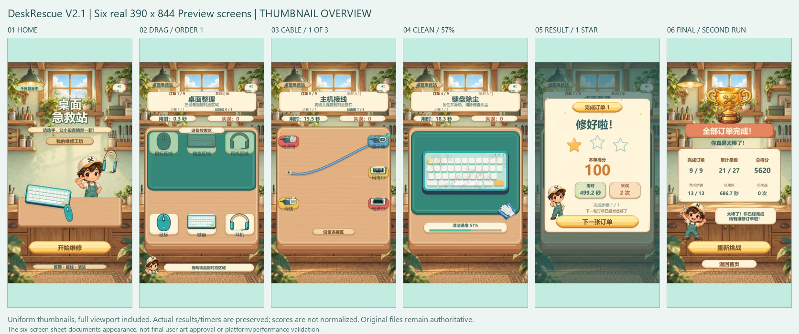

# DeskRescue V2.1 / 0.0.5-alpha.3：Creator 与 Preview 验证

更新时间：2026-10-15，项目 `D:/game`，Cocos Creator 3.8.8 / TypeScript 5.8.2。**本轮本地源码、素材、场景实施和下述桌面验证已完成；六屏美术终审仍待用户看图确认。** 不把 synthetic event、离线 mock、浏览器鼠标或 ZIP 解压校验称为物理触屏、平台构建或第二台电脑复现。用户本轮任务书完整原文另存 [V2.1任务归档](DESKRESCUE_V21_TASK.md)，[来源SHA](validation/day5a-plus/v21/task-provenance.json)；它不是验收结论。

## 1. 基线与保护

实际分支 `feature/day5a-visual-playable`，HEAD `ffde65700d6fa8c5ddd6daf2ca43e30dbdf3ee22`。开始时 alpha.2、512 条未提交状态、654 个 Git 可见文件、暂存区空。基线 SHA-256：`9b05be70ef51312b0f74ad9604f8b3ad023a7f104130b9a024b4ce41939ed09e`，见 [baseline.json](validation/day5a-plus/v21/baseline.json)。项目外预修改备份 35,926,325 字节，SHA `3cd85aa30ae878042df41d1c7bf11c0c1e6809f27a8f6892fb16252db1ba79ac`，路径与每项校验见 [phase0-summary.json](validation/day5a-plus/v21/phase0-summary.json)。

保留所有已有 Day5A/V2 未提交成果。RunController、DraggableItem、CableConnector、OrderCatalog、StageDefinition，以及 Drag/Cable Stage 控制器保持本轮开始时原字节。CleanSwipeStageController 仅加入可选 dustView 引用、configure 与已接受路径的 sweep 通知；原计数、触摸所有权、END/CANCEL、generation、缓存池、0.08 秒淡出未改。原 174 组断言继续执行。旧 64 PNG、7 WAV、设计包和历史验收证据不覆盖。最终逐文件修改理由、SHA、原字节保护结果与完整路径见 [preservation.json](validation/day5a-plus/v21/preservation.json)，不是以 Git HEAD 替代未提交基线。

## 2. 实施与保存

[精修记录](DAY5A_PLUS_V21_REFINEMENT.md) 给出阶段和文件职责。新增独立 192 粒软尘视图；增强 18 张线头/接口、19 张设备共 37 PNG（590,483 字节）及 37 SVG；可选 refinedLayout/refinedStyle；四层线路、真实连接灯；结算层级和星星错峰；首页/最终页小幅比例调整。保持 49 个资源 key 和业务数据不变。

保存通过当前真实 Editor 的 Node/Component、Prefab 序列化、Asset Database 导入与场景保存 API 完成。没有手写 Scene/Prefab JSON、伪造 meta 或更换核心 UUID。新增图与脚本 meta 均由 Creator 导入。入口是 DeskRescue/V2.1：Ctrl+Alt+S 样板、D 精修、F 全量、J 导入、K 审计、L 引擎夹具。正常试玩直接打开 `assets/scenes/Game.scene` 后 Preview；无需重跑旧 Day3/Day4 重建。

| 本轮实际证据 | 结果 | 范围 |
| --- | --- | --- |
| [sample 保存审计](validation/day5a-plus/v21/audit-sample.json) | 1245/1245 | 清洁4、接线5先行样板 |
| [refine 保存审计](validation/day5a-plus/v21/audit-refine.json) | 1248/1248 | 拖拽/结果层级 |
| [full 保存审计](validation/day5a-plus/v21/audit-current.json) | 1319/1319 | 2026-10-15 12:31:52.590 UTC，最终已保存资源 |
| [full 增量装配](validation/day5a-plus/v21/build-full.json) | 两遍均成功；第二遍九资源新增节点0 | Game.scene＋8核心Prefab，幂等且未重建正式工程 |
| UUID/meta/Inspector | 9核心资源UUID/meta保持，175项meta、101PNG、7WAV、49 Registry key | 16个输入节点及祖先 parent/layer/position/rotation/scale/anchor/size 严格比对，434重点文件保护；686个保存文件SHA绑定 |
| [真实引擎夹具](validation/day5a-plus/v21/engine-probe.json) | 46/46 | 12:36:55.193 UTC，原18核心＋18 V2＋10 V2.1 |

夹具实际加载当前保存 Prefab、注册类，构造真实 `cc.Touch/EventTouch` 并向离场节点 emit；隔离 ActionManager 以手动 dt 推进补间。44个夹具清理，恢复原 TweenSystem，正式 Scene 未变，cleanupErrors 为0。涵盖三玩法、旧/新布局、端点及颜色/连接灯、尘团路径/复位/只读、星级补间、按钮防重入、池和生命周期。它不证明浏览器命中、自然音频结束、画面剪裁或物理触摸；这些边界在 JSON 原文保留。装饰层无 Button/BlockInputEvents/Touch，既有结算遮罩继续阻止背景操作。

## 3. 命令、独立 mock 与 SDK

Node v22.19.0、npm 10.9.3、TS 5.8.2。实际时间、命令、退出码、日志SHA见 [final-commands.json](validation/day5a-plus/v21/final-commands.json)，后续仅对比较工具的变更补充 [最终语法记录](validation/day5a-plus/v21/final-syntax-supplement.json)。

| 命令/环境 | 实际结果 |
| --- | --- |
| Phase0 独立无 temp 基线 | exit1，恰4条 TS2339：Color.r/g/b/a 缺声明 |
| 仅补现有 mock 的4个数值声明后 | 独立副本 exit0，原174组通过；用户 temp 原样保留 |
| 最终 `npm test` | exit0，207＝174历史＋17清洁＋16其他视觉组；不是新增207组 |
| 最终独立无 Creator temp/library/.git/node_modules 副本 | [final-offline.json](validation/day5a-plus/v21/final-offline.json)：TS5.8.2、207组、exit0、42个runtime/test/config绑定，原项目生成配置未变 |
| `npm run check:cocos` | exit0，真实 Editor 生成SDK引用，strict/noUnusedLocals/noUnusedParameters 启用，项目源码通过 |
| `npm run check:cocos -- --check-sdk-declarations` | **exit1，安装SDK自身102条历史诊断**：18 jsb＋84 cc；未改SDK、未降strict，不能称SDK通过 |
| JS/CJS/MJS `node --check` | 实际25个文件全部通过，包含原day1/day4/day5a与新V2/V2.1工具 |
| Python语法 | 原最终命令11/11；比较工具随后更新，补充记录重新核对当前源码 |

## 4. 真实 Preview 范围与成绩

实际地址 `http://localhost:7456/`，三个视口各自设置后重新载入，Info debug。仅使用真实界面鼠标点击/拖拽；没有注入完成状态、改分数、修改业务时钟或延迟结算来拍照。自然用时包括工具超时、观察和停留，不能当速度或 FPS 基准。

| 视口/轮次 | 覆盖 | 实际最终统计 | 入口与状态 |
| --- | --- | --- | --- |
| 390×844 第一轮 | 九单、十三步、三玩法、错误回位/吸附 | 9/9、13/13、19/27星、4290分、903.9秒、3错 | Final→Home→Start；第一单受工具中断停留影响，实际499.2秒/2错/100分/1星，未替换成绩 |
| 390×844 第二轮 | 九单、十三步、2/3/4物件、2/3/4线、三清洁设备 | 9/9、13/13、21/27星、5620分、686.7秒、0错 | Final→直接Replay，新第一单可操作；清洁视图重置可见 |
| 768×1024 | **第1～5单**：首页、拖拽、清洁、接线、各单结算/下一单 | 第一单990分、1.4秒、0错、3星 | 不声称该尺寸完整九单或最终双按钮覆盖 |
| 1280×720 第一轮 | 九单、十三步、三玩法 | 9/9、13/13、24/27星、6670分、296.6秒、0错 | Final→直接Replay，新第一单在工具画面观察到；早截的同名Replay文件仍是总结，不能当重玩后截图 |
| 1280×720 第二轮 | Replay后九单、十三步；静音状态贯穿 | 9/9、13/13、26/27星、7160分、187.8秒、0错 | Final→Home→Start，0/3/零错和OFF保留；实际保存的再次Start图已自然计时144.4秒，不能称0秒截图 |

390主验收已保存订单1辨识/错误回弹/正确放置、订单4的0/57/96、局部回扫仍57、订单5的0/1/错误回位/成功灯、订单8四物件/两线、订单9四线/四件和最终总结。三尺寸均有清洁0/57/96和接线0/1/结算。57%＝16/28、96%＝27/28；真正第28格触发结算，不是按图片可见灰尘比例判定。三/四线最后吸附后直接结算或换步，所以 pending 原图不冒充成功全连，未取得无遮挡3/3图。

SHOW_ALL 保持：390上下薄荷留边约75.3333px，768左右96px，1280左右437.5px；canvas DOM rect仍等于对应视口，未缩改输入坐标。[DOM390](validation/day5a-plus/v21/dom-390.json)、[DOM768](validation/day5a-plus/v21/dom-768.json)、[DOM1280](validation/day5a-plus/v21/dom-1280.json)。这是Web CSS clip与补边，宽屏仍有明显留边，未声称全幅原生场景延展。结束时已reset临时视口、重载首页并保留Preview标签。

实际逐图时间/尺寸/SHA、错误命名更正见 [截图清单](validation/day5a-plus/v21/comparisons/final-screenshot-inventory.json)，原始捕获行为见 [ledger](validation/day5a-plus/v21/preview-capture-ledger.json)，准确范围/成绩另见 [preview-verification.json](validation/day5a-plus/v21/preview-verification.json)。截图命名不替代实际像素判读。

## 5. 控制台与恢复经过

最终浏览器保留的 warn/error 捕获为 **0**，原始返回见 [preview-console-final.json](validation/day5a-plus/v21/preview-console-final.json)。这只表示捕获服务当时保留的记录，不代表整个Creator历史会话零错误。

本轮首次样板导入出现 `import://...Port` 临时资源加载失败，保留 [failure-1792065909697.json](validation/day5a-plus/v21/failure-1792065909697.json)。增加有界资源加载重试后，sample/refine/full真实保存及最终1319/46通过。旧V2的资源锁/JSON失败仍保留旧报告，不改成新版本通过证据。真实Preview期间素材导入曾自动reload回首页、浏览器操作曾超时；旧首页误命名为回弹/结算、pending误命名为result、Replay提前截图等均保留并在清单更正，后续稳定结果补证，不清除失败历史。

## 6. 视觉结果与仍不足

| 页面 | 已提升 | 保留差距 |
| --- | --- | --- |
| 首页 | 角色和Logo略增大，原工坊、色板和开始入口保留 | 比例保守；静态插画层次不等于设计图全部光照/细节 |
| HUD/拖拽 | 子设备裁去透明边、主体和标签增大，槽位对比增强 | 手机原尺寸4件标签仍紧凑；设备仍为既有插画风格 |
| 接线 | 不同head/port厚度、金属边、针脚/凹槽、插入方向；四层弧线和真实连接灯 | 3/4线交叉与右侧短标签仍需用户原尺寸审阅；最后成功直接换页，不能伪造全连停留 |
| 清洁 | 192个独立错落软尘沿已接受路径局部消退，不再由整行逻辑格控制可见图 | 斜/弧57%较自然；**长水平直擦仍会形成可感知带状边界**。没有逻辑格边框，不等于任意路径都消除条带感；是否达到用户自然擦除预期尚未确认 |
| 单单结算 | 金徽章、欢呼标题、大分数、错峰星星、角色与统计卡层级更清晰 | 极低/极高实际用时仍如实显示；美术比例和动画主观感受待审 |
| 最终总结 | 角色/字号小幅增强，六项统计独立，双入口实测 | 保持原构图和SHOW_ALL留边，不是设计图像素级复刻 |

同视口原像素比较：[首页](validation/day5a-plus/v21/comparisons/final-home-v2-to-v21.png)、[斜/弧清洁57%](validation/day5a-plus/v21/comparisons/final-clean57-v2-to-v21.png)、[水平57%补充](validation/day5a-plus/v21/comparisons/final-clean57-horizontal-v2-to-v21.png)、[接线1/3](validation/day5a-plus/v21/comparisons/final-cable1-v2-to-v21.png)、[单单结算](validation/day5a-plus/v21/comparisons/final-result-v2-to-v21.png)。外置标签，不替换游戏像素；源图SHA与嵌入回读见 [比较清单](validation/day5a-plus/v21/comparisons/final-comparison-manifest.json)。清洁路径不同，旧接线成功为电源/新为显示，结算自然成绩不同，不能当相同输入的受控实验。**未经用户审阅，不声称六屏美术终审通过。**

## 7. 交付、未测与继续方式

完整项目ZIP用 [package_v21_delivery.py](../tools/package_v21_delivery.py) 写到 `D:/game-deliverables`，不覆盖旧包。内置 `DELIVERY_MANIFEST.json` 含源码、素材/meta、Scene/Prefab、配置、Editor扩展、测试、SVG/master/脚本、原设计和历史/本轮证据；排除.git/library/temp/profiles/node_modules/build与敏感缓存。项目外 `.delivery.json` 记录实际ZIP路径/大小/SHA及CRC、逐条SHA/size、全新目录解压核对结果；最终回执以该实际结果为准，避免在包内写入包自身SHA的循环依赖。

本轮未测：物理触屏、浏览器原生Touch/TOUCH_CANCEL、手机WebView、微信/抖音真机与平台构建、FPS/帧时间、独立音频听感。音效仅验证界面ON/OFF/session保留、已有7音效引用与夹具静音契约。安装SDK自身102条诊断仍未修复。后续用户可先审阅五组对比，特别水平擦拭边界；继续视觉调整属于另一次增量修改，不能把待审意见写成已通过。

所有成果仍为本地未提交。最终Git数量见保护报告和项目外交付清单，暂存区空、HEAD/分支与基线一致。未执行git add/commit/push/tag/reset/clean/stash、发布、Day5B/5C。
