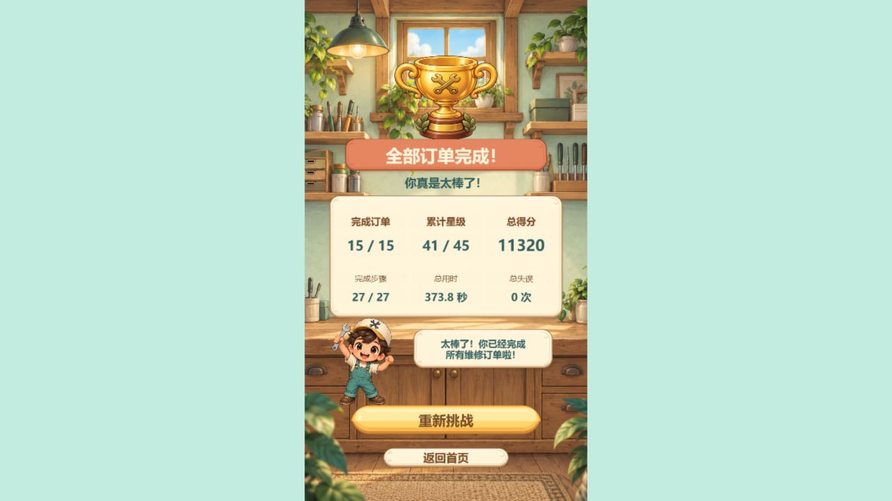
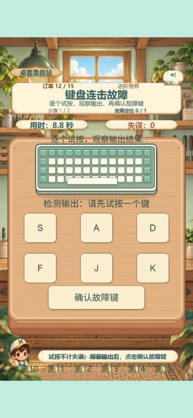
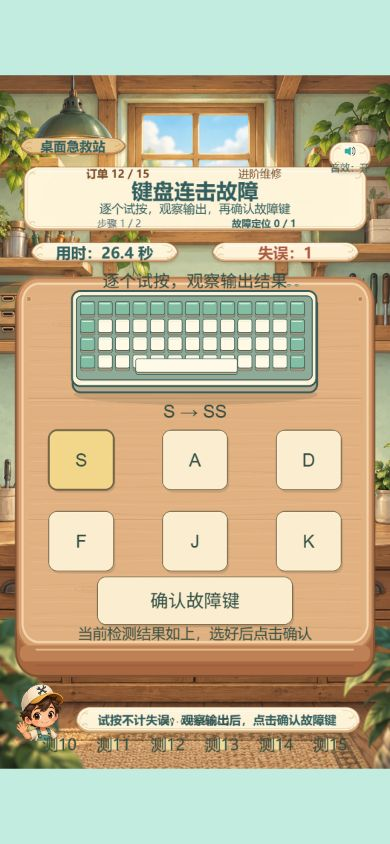

# Day5B final polish：Creator / Preview 验证

日期：2026-10-19（Asia/Shanghai）。版本0.0.5-alpha.5，Creator3.8.8，设计720×1280 SHOW_ALL。

## 自动检查

真实运行 `python tools/run_day5b_checks.py`，内部实际执行 `npm test`、`npm run check:cocos`、SDK声明单独检查及所有JS语法检查（包含 `node --check tools/verify-day1.cjs`）。命令、退出码和原始输出SHA见 [commands.json](validation/day5b/final-polish/commands.json)，源绑定见 [checks.json](validation/day5b/final-polish/checks.json)。

|检查|实际结果|
|---|---|
|有限mock行为|293/293，原275+新增18，exit0|
|真实Creator项目strict|0项目错误，exit0，TS5.8.2|
|安装SDK声明自身|102条，exit1，已知单列，非项目错误|
|JS / Python语法|45 / 22 文件通过|
|原创图像验证|确定性源稿/PNG字节通过|

## 真实 Editor 与引擎

通过Creator原生快捷入口和AssetDB装配、snapshot、save-scene保存Game.scene；重复装配复用五Prefab，没有直接编辑序列化JSON。最终场景qaEnabled=false、ReviewRoot inactive。

- [editor-audit.json](validation/day5b/final-polish/editor-audit.json)：原21+QA默认隐藏2项，23/23。
- [engine-probe.json](validation/day5b/final-polish/engine-probe.json)：原8项+实际诊断+实际发布保护，10/10；真实cc.Node/Touch/EventTouch、原生Prefab，手动dt和隔离ActionManager，不冒充自然Preview。
- [preservation.json](validation/day5b/final-polish/preservation.json)：1357文件外部基线、0缺失；29个Prefab相关目录/资源/meta文件字节冻结，211个资产meta无重复UUID；原场景节点位置/尺寸/层级身份保持。源SHA当前绑定，历史报告单列。
- 五新Prefab UUID及15 SpriteFrame实际引用见审计；运行PNG/SVG源稿、meta与源码SHA见current sourceBindings、change-inventory及asset-sources清单。本轮未新增素材或meta。

### 发布环境 QA 保护证据

[release-gate.json](validation/day5b/final-polish/release-gate.json) 调用当前安装SDK的 `setupBuildTimeConstants({mode: BUILD, platform: HTML5, flags:{DEBUG:false}})`，实际得到BUILD=true/PREVIEW=false/DEBUG=false。使用SDK随附TS4.9.5编译实际 `Day5BReviewLauncher.ts`，在真实cc引擎Node/Button/Component中执行。即使强设qaEnabled=true，rootActive=false、绑定0、触发按钮后的QA动作0。源代码与SDK常量生成器SHA保留。

这是任务书允许的环境宏与实际组件同级证明，**不是完整Web/Mobile Release构建或小游戏平台运行**。没有用mock单独替代该门禁。

## 真实 Preview

浏览器CUA鼠标实际操作 localhost Creator Preview；各视口分别set并reload初始化。没有读写隐藏游戏状态、注入得分或把参考图当UI。[preview-verification.json](validation/day5b/final-polish/preview-verification.json)、[60张初始截图清单](validation/day5b/final-polish/screenshot-inventory.json) 提供详细证据；实际清单数量以JSON为准。

|视口|实际覆盖与结果|
|---|---|
|390×844|普通首页QA隐藏；显式QA部分轮第12单从初始中性、A单字、重复错误确认只记一次、S双字待确认，到正确确认、序列及结算。2/2步，100分、1星、552.1秒、1失误。10/11/13/14/15均实操关键步骤，标签不交叉遮挡。|
|768×1024|独立初始化QA部分轮，第12单诊断+序列+结算：350分、1星、65.6秒、0失误；第14单定位与双滑块调入绿色；恢复正式场景后首页正常。不是完整15单；耳机最终结算未截图，Editor保存触发自动刷新。|
|1280×720|普通QA关闭，从首页连续15单27步，自然最终15/15、27/27、41/45星、11320分、373.8秒、0失误。自然终局返回首页→开始正常；另行显式QA定位15单并手动完成3步，部分轮1/15、3/27、2星、320分、68.3秒、0失误，用于验证重新挑战回到第1单并拖拽成功。|

最终控制台捕获warn/error为空。QA显式测试轮截图有定位按钮是预期，仅部分轮；最终保存与普通Preview恢复关闭，临时视口override已reset。

## 证据与限制

初次装饰遮挡截图、裸装饰器失败日志、旧场景绑定失败及历史导入问题均保留，不能把prior文件作为当前通过证明。公开路径匿名化前原件保存在项目外，历史SHA不随匿名化“修正”，桥接记录分别给原/公开SHA。

真实鼠标、实际引擎合成Touch、物理手机三者分开陈述；后者未做。原生浏览器TOUCH_CANCEL、多指/物理触屏、微信/抖音、WebView、发布、FPS、人类难度校准未验。计时包含工具暂停，不推断玩家速度。未合并main，未发布，未进入Day5C；Git推送最终状态以独立实际publication收据为准。
